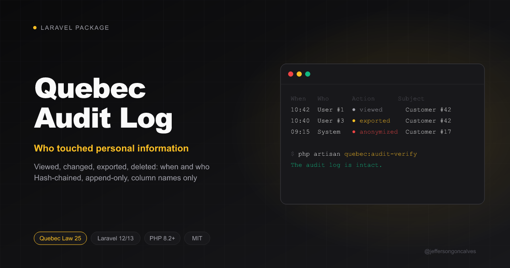

# Laravel Quebec Audit Log



[](https://packagist.org/packages/jeffersongoncalves/laravel-quebec-audit-log)
[](https://github.com/jeffersongoncalves/laravel-quebec-audit-log/actions/workflows/tests.yml)
[](https://packagist.org/packages/jeffersongoncalves/laravel-quebec-audit-log)

Quebec's private sector privacy act (Law 25) makes the business responsible for protecting the personal information it holds (s. 3.1) and asks for security measures that are reasonable given its sensitivity (s. 10). This package keeps an audit trail of who viewed, changed, exported or anonymized personal data, built on [laravel-quebec](https://github.com/jeffersongoncalves/laravel-quebec)'s `#[PersonalData]` declarations.

- **Column names, never values:** the log itself doesn't copy the data it protects.
- **Append-only and hash-chained:** each entry carries an HMAC of the previous one. `quebec:audit-verify` tells you if an entry was altered, removed from the middle or inserted.
- **Automatic where Eloquent can see it:** changes to personal data columns, deletions, and every anonymization (destruction on request, retention).

> This package gives you tooling. It does not make you compliant on its own.

## Installation

```bash
composer require jeffersongoncalves/laravel-quebec-audit-log
php artisan vendor:publish --tag="quebec-audit-log-migrations"
php artisan migrate
```

Set `QUEBEC_HASH_KEY` (see laravel-quebec). The chain falls back to `APP_KEY`, and rotating the key makes older entries fail verification.

## Usage

Add the trait to the models that hold personal data:

```php
use JeffersonGoncalves\QuebecAuditLog\Concerns\AuditsPersonalData;

#[PersonalData('email', anonymize: AnonymizeStrategy::Hash)]
class Customer extends Model implements HasPersonalData
{
    use AuditsPersonalData;
    use InteractsWithPersonalData;
}
```

- Updating a declared column logs `updated` with the column names. Other columns are ignored.
- Deleting the model logs `deleted`.
- `anonymizePersonalData()`, called directly, by [laravel-quebec-dsar](https://github.com/jeffersongoncalves/laravel-quebec-dsar) or by [laravel-quebec-retention](https://github.com/jeffersongoncalves/laravel-quebec-retention), logs `anonymized`. That save also logs `updated` first.

Eloquent can't tell when data is read, so log access where you show it:

```php
$customer->auditAccess('Support ticket #42');            // all declared columns
$customer->auditAccess('Billing', ['email']);

QuebecAuditLog::record('exported', $customer, ['email'], 'Answer an access request', ['ticket' => 42]);
```

The actor is the authenticated user unless you pass `actor:`. The IP address and user agent of the request are stored too (`store_request`). They are personal data, so they stay out of the hash chain and can be anonymized without breaking it.

### Verifying

```bash
php artisan quebec:audit-verify
```

```php
// routes/console.php
Schedule::command('quebec:audit-verify')->daily();
```

The oldest entry you kept is trusted as the start of the chain, so deleting old entries from the start keeps the rest verifiable. A gap in the middle does not.

## Testing

```bash
composer test
```

## Changelog

See [CHANGELOG](CHANGELOG.md).

## License

The MIT License (MIT). See [License File](LICENSE.md).
